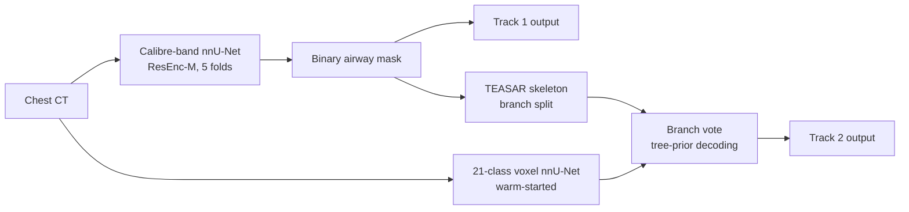

<h1 align="center">
<strong>CaliTree: Calibre-Band Airway Segmentation and Tree-Consistent Branch Labelling</strong>
</h1>

<div align="center">

<a href="https://git.io/typing-svg">

</a>

[](https://atm26.grand-challenge.org/)
[](https://huggingface.co/adidukre/CaliTree)
[](#-method)
[](#-docker)
[](https://visitorbadge.io/status?path=https%3A%2F%2Fgithub.com%2Fadinathdukre%2FCaliTree)

<h3>🤗 <a href="https://huggingface.co/adidukre/CaliTree">Weights</a> &nbsp;|&nbsp; 🧠 <a href="#-method">Method</a> &nbsp;|&nbsp; ⚡ <a href="#-inference">Inference</a></h3>


</div>

## 🔥 News
- **[30 Sep 2026]** 🚀 Code, Grand Challenge containers and weights for both ATM'26 tracks are released.

## Overview
**CaliTree** is a two-track solution to the [ATM'26 challenge](https://atm26.grand-challenge.org/) (MICCAI 2026):

| Track | Task |
|---|---|
| **Track 1** | Binary airway segmentation from chest CT |
| **Track 2** | Branch-wise anatomical labelling of the airway tree into 20 classes (trachea plus 19 segmental bronchi) |



## 📖 Contents
- [🧠 Method](#-method)
- [⛏️ Installation](#️-installation)
- [🧩 Weights](#-weights)
- [⚡ Inference](#-inference)
- [🐳 Docker](#-docker)
- [🏋️ Training](#️-training)
- [🗂️ Repository Layout](#️-repository-layout)
- [📨 Contact](#-contact)

## 🧠 Method

### Track 1: calibre-band segmentation
- **Backbone.** nnU-Net v2 with a residual encoder (ResEnc-M, `3d_fullres`), 5-fold ensemble.
- **Calibre-band targets.** Each airway voxel gets the calibre of its nearest centerline point (large, mid or distal) plus a centerline-tube flag. The network is trained on four nested regions: airway, mid+distal, distal and centerline.
- **Loss on the airway channel:**
  - region BCE + Dice
  - General Union Loss (alpha 0.1)
  - Skeleton Recall on the centerline region
  - a soft-skeleton precision term (the precision half of clDice, weight 0.25)
- **Inference.** Sliding window (tile step 0.75) with single-axis flip TTA. The airway, mid+distal and distal channels are each thresholded at 0.3 and their union is taken, then a largest-connected-component filter is applied.

### Track 2: tree-consistent branch labelling
1. **Segment.** A Track-1 style calibre-band segmenter produces the binary airway mask.
2. **Label voxels.** A 21-class nnU-Net (`3d_fullres_SAS`, no mirroring) labels voxels. It was warm-started from the official ATM'26 Track-2 baseline weights and fine-tuned for 1000 epochs.
3. **Decode branches.** A TEASAR skeleton of the airway mask splits it into branches. Each branch gets one label from a vote over the voxel predictions, decoded under a tree prior, and the labels are rasterised back to the mask.

## ⛏️ Installation

```bash
git clone https://github.com/adinathdukre/CaliTree.git
cd CaliTree
pip install -r requirements.txt
```

## 🧩 Weights

```bash
huggingface-cli download adidukre/CaliTree --local-dir /path/to/weights
```

```text
/path/to/weights/
├── track1/   postproc.json, nnUNet_ckpts/ (5 folds)
└── track2/   postproc_t2.json, nnUNet_ckpts/ (segmenter, 5 folds), nnUNet_t2warm/ (21-class model, 5 folds)
```

## ⚡ Inference

The input folder holds CT volumes as `.mha` files (`<case>_0000.mha` or `<case>.mha`).

```bash
# Track 1: writes /path/to/output/images/binary-airway-segmentation/<case>.mha
ATM_RESOURCES=/path/to/weights/track1 ATM_INPUT=/path/to/ct_folder ATM_OUTPUT=/path/to/output \
    python docker/T1/inference.py

# Track 2: writes /path/to/output/images/multi-class-airway-segmentation/<case>.mha
ATM_RESOURCES=/path/to/weights/track2 ATM_INPUT=/path/to/ct_folder ATM_OUTPUT=/path/to/output \
    python docker/T2/inference.py
```

> [!NOTE]
> With one input case, the output is named `output.mha`.

**Optional arguments:**

| Variable | Default | Purpose |
|---|---|---|
| `ATM_DEVICE` | `cuda` | set to `cpu` to run without a GPU |
| `ATM_FOLDS` | all | segmentation folds, e.g. `0,1` |
| `ATM_TILE_STEP` | `0.75` | sliding-window step |
| `ATM_WARM_FOLDS` | `0` | Track-2 21-class model folds |

## 🐳 Docker

The images follow the ATM'26 Grand Challenge and batch contract: they read `/input/images/lung-ct/*.mha` and write to `/output/images/<slug>/`. They build on the organisers' CUDA 11.8 nnU-Net base image, `atm26-nnunetv2:2.6.4-cuda11.8`.

```bash
bash docker/T1/build.sh /path/to/weights/track1 atm26-track1
bash docker/T2/build.sh /path/to/weights/track2 atm26-track2

docker run --rm --gpus all -v /path/to/input:/input:ro -v /path/to/output:/output atm26-track1
```

> [!TIP]
> To also export a `.tar.gz` of the image, set `ATM_EXPORT=1` when you build.

## 🏋️ Training

```bash
export ATM_DATA=/path/to/workdir
source scripts/env.sh
```

<details open>
<summary><strong>Track 1</strong> (Dataset501, calibre bands)</summary>

```bash
python scripts/prepare_nnunet_track1.py \
    --images /path/to/ATM26/Track-1/imagesTr --labels /path/to/ATM26/Track-1/labelsTr
bash scripts/plan_preprocess_t1.sh
for f in 0 1 2 3 4; do bash scripts/train_t1.sh $f; done                               # Track-1 model
for f in 0 1 2 3 4; do bash scripts/train_t1.sh $f nnUNetTrainerAirwayCB; done         # Track-2 stage-1 segmenter
```

</details>

<details open>
<summary><strong>Track 2</strong> (Dataset502, 21 classes)</summary>

> [!IMPORTANT]
> This track needs the official ATM'26 Track-2 baseline weights, which are used for the warm start.

```bash
python scripts/prepare_nnunet_track2.py \
    --images /path/to/ATM26/Track-1/imagesTr --labels /path/to/ATM26/Track-2/labelsTr
nnUNetv2_extract_fingerprint -d 502
python scripts/prepare_t2_plans.py --baseline-plans /path/to/t2_baseline/nnUNet_ckpts/plans.json
nnUNetv2_preprocess -d 502 -plans_name nnUNetPlansOrg -c 3d_fullres_SAS
export ATM_T2_INIT=/path/to/t2_baseline/nnUNet_ckpts
for f in 0 1 2 3 4; do bash scripts/train_t2.sh $f; done
python scripts/patch_t2_resampling.py $nnUNet_results/Dataset502_ATM26Track2Seg/nnUNetTrainerT2Warm__nnUNetPlansOrg__3d_fullres_SAS/plans.json
```

`patch_t2_resampling.py` switches the 21-class probability resampling to nnU-Net's torch resampler. This keeps inference memory well below 32 GB.

</details>

## 🗂️ Repository Layout

```text
CaliTree/
├── airway/
│   ├── losses/       # General Union, Skeleton Recall and soft-skeleton precision losses
│   ├── inference/    # post-processing, batch I/O, Track-2 voxel model and tree decoding
│   ├── graph/        # TEASAR branch extraction and the 21-class taxonomy
│   └── eval/         # connected-component and skeleton utilities
├── nnunet_trainers/  # custom nnU-Net trainers (nnUNetTrainerAirwayCB_clprec025, nnUNetTrainerT2Warm)
├── scripts/          # dataset preparation, planning and training
└── docker/
    ├── T1/           # Track-1 submission container and entry point
    └── T2/           # Track-2 submission container and entry point
```

## 📨 Contact
For questions or collaboration, please open an [issue](https://github.com/adinathdukre/CaliTree/issues) or reach out to [Adinath Madhavrao Dukre](https://github.com/adinathdukre).

> [!IMPORTANT]
> CaliTree is intended for research only. It is not approved for clinical use and must not inform any diagnostic or treatment decision.
